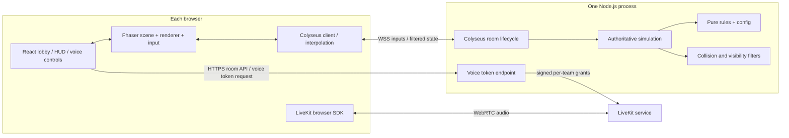

# OSMOSIS — Technical Architecture & Agent Guardrails

**Version:** 1.0 · **Status:** Binding implementation anchor · **Companion:** `PRD.md`

> The PRD owns player-facing behavior. This document owns modules, boundaries, protocols, trust, quality gates and implementation constraints. Agents must not silently swap stack, invent a database, introduce microservices or let client code resolve points/battles.

## 1. Locked technical decisions

| Concern | Decision |
|---|---|
| Client shell | React + TypeScript + Vite |
| Game rendering | Phaser 3 (2D top-down; Arcade Physics for local prototype and visual collisions) |
| Styling | Tailwind CSS for menus and HUD; DOM overlay above canvas |
| Multiplayer | Node.js + TypeScript + Colyseus room; WebSocket state/events |
| Source of truth | Colyseus server owns simulation, positions, collisions, LOS, score, clock, link state and results |
| Voice | LiveKit client SDK/WebRTC, separate audio room per team; tokens minted **server-side** |
| Persistence | None for v1; matches/rooms in memory; ephemeral signed reconnect tokens |
| Hosting | One Node.js game server + static web app; optional separately hosted/self-hosted LiveKit |
| Workspace | pnpm monorepo with shared TypeScript domain/contracts |
| Target | Desktop web browsers; private 10-player rooms, 15-minute games |

**Version discipline:** pin working major/minor dependency versions at project initialization, commit lockfile, and document upgrades. Do not copy API examples from a different Colyseus major version without verifying documentation.

## 2. Diagram



## 3. Repo boundaries

```text
osmosis/
  apps/
    web/
      src/
        pages/             # home, lobby, allocation, arena, results
        game/              # Phaser scenes, tilemaps, sprites, camera, fog
        ui/                # React HUD and menus
        net/               # typed Colyseus adapter, interpolation
        voice/             # LiveKit SDK wrapper, permissions, controls
    server/
      src/
        rooms/             # one GameRoom and its lifecycle/phases
        simulation/        # tick, movement, collision, battle, LOS
        systems/           # pickup, link, base, timer, reconnection
        security/          # input validation, privacy view, tokens
        http/              # health + voice-token endpoint
  packages/
    shared/
      src/
        contracts/         # client commands / server events / types
        constants/         # rules, movement, arena dimensions, timings
        map/               # canonical collision and LOS geometry
  tests/
    integration/           # rooms, privacy, match orchestration
    e2e/                   # two+ browser flows; mock voice in CI
  docs/
    PRD.md
    ARCHITECTURE.md
```

**Dependency rule:** `web` and `server` may import `shared`; `shared` imports neither. Phaser code never runs on the game server. Shared geometry is pure data and deterministic TypeScript math, not Phaser physics objects.

## 4. Authoritative simulation

- Fixed simulation step target **20 ticks/sec** (50ms); client renders at display refresh rate and interpolates remote avatars.
- Clients send **intent** (`move` input direction, `interact`, `linkStart`, `linkStop`, `ping`), never coordinates as facts, scores or collision outcomes.
- Server computes speed-limited movement and canonical map collisions, then determines LOS, interactions and scoring.
- Client may predict **its own** movement and reconcile to server snapshots; remote players interpolate. No client-side optimistic score changes.
- Process input sequence numbers/timestamps to reject stale or repeated commands; rate-limit inputs and HTTP endpoints.
- Use server monotonic elapsed time for 900s match; expose timestamp/deadline to clients; server decides on exact timeout.
- The match is authoritative **even if a client opens devtools or tampers with Phaser**.

### State partitioning (critical)

**Do not broadcast complete raw game state to all clients.** Vanilla shared Colyseus schemas may expose every player's coordinates/points. Use per-client visibility (Colyseus State View if supported by pinned version, or carefully controlled client-specific snapshots), backed by server-side line-of-sight, to prevent hidden enemy leakage.

| Field | Authorized audience |
|---|---|
| Own points, status, position | Self |
| Team roster and teammate positions/status | Same team |
| Teammate points | Same team (team strategy) |
| Enemy avatar position, name | Only while inside server-computed field-of-view and unoccluded |
| Enemy exact points | Never during match |
| Map obstacle geometry, visible pickups | Static public map; item visibility under local fog |
| Team score | Both teams (aggregate only) |
| Team voice authorization | Member of matching team only |
| End-of-match full breakdown | All players after result phase |

**Fog/security distinction:** A dark overlay alone is only visual; visibility **must also filter network data**. Team locations can appear on own minimap; enemy minimap is limited to currently spotted enemies (or omit enemy markers in v1).

## 5. Match lifecycle / state machine

```text
CREATED -> LOBBY -> ALLOCATION -> COUNTDOWN -> PLAYING -> RESULTS -> LOBBY (rematch)
                              \-> LOBBY (cancellation)
```

Only server performs transitions. Lobby requires 5 players/team; allocation must sum to 10,000/team and be locked; countdown requires all connected players ready; start initializes spawns, items, timestamp and active status atomically. `RESULTS` is terminal for the round; rematch creates fresh round state without leaking prior scores.

### Roles
- **Host:** can start/cancel countdown and rematch; not automatically a team captain.
- **Captain:** can submit/lock allocation for own team.
- **Player:** nickname, ready, move, battle, link, raid, voice, ping.
- Role assignment and transfer are server-validated. Never trust a client-provided `isHost` or `isCaptain` flag.

## 6. Contracts (conceptual, version and validate actual payloads)

```ts
type ClientCommand =
  | { type: 'move'; seq: number; dx: -1 | 0 | 1; dy: -1 | 0 | 1 }
  | { type: 'interact'; targetId?: string }
  | { type: 'linkStart'; teammateId: string }
  | { type: 'linkStop' }
  | { type: 'ping'; x: number; y: number; kind: 'help' | 'attack' | 'defend' }
  | { type: 'ready'; ready: boolean }
  | { type: 'allocate'; pointsByPlayerId: Record<string, number> }
  | { type: 'lockAllocation' };

type MatchPhase = 'LOBBY' | 'ALLOCATION' | 'COUNTDOWN' | 'PLAYING' | 'RESULTS';
```

Use an explicit schema validator (e.g. Zod) at the network boundary. Send server events for `battleResolved`, `pointsChanged`, `itemCollected`, `raidStarted/Interrupted/Completed`, `playerInactive/Rearmed`, `matchEnded`, `error`. Event recipient and secrecy are explicit; never emit points-change payloads revealing opponent balance.

## 7. Gameplay systems and invariants

| System | Server invariant |
|---|---|
| Team allocation | Exactly 10,000 per team; 100-point increments, each >=0; locked before start |
| Movement | Never crosses blocked tile or bounds; collision math deterministic |
| LOS | Occlusion computed from map wall segments; no unseen enemy position serialized |
| Battles | Only ACTIVE opponents in contact; compare points/linked team; each contact resolves once |
| Score transfer | Winner gain equals loser debit, max 500; no negative scores; simultaneous input ordering deterministic |
| Inactivity | Participating battlers marked INACTIVE; only own base restores ACTIVE |
| Links | Max two ACTIVE allies within range + LOS; terminate on distance, disconnect or inactivity |
| Pickups | Each pickup awarded once; award 200 to collector |
| Raids | 3s uninterrupted base interaction, 2,000 reward, 90s per-team raid cooldown; defenders interrupt |
| Finish | Exactly one server result after 900s; total comparison; tie = draw |

**Collision resolution:** Phaser Arcade Physics handles rapid local prototyping and visuals. Server uses matching pure AABB/circle geometry from `shared/map` (not Phaser on the server). Test boundary and high-latency cases. Prefer collision shapes aligned with rendered container footprints.

**Combat trigger:** Start a battle on the first valid opposing-player contact edge, not every frame while two sprites overlap. A short contact lock suppresses duplicate events; inactive characters cannot trigger it.

## 8. Voice architecture

- On entering match/lobby, client explicitly requests microphone permission before publishing audio.
- Client calls game server's authenticated `/voice/token` endpoint with its reconnect/session credential.
- Server verifies live membership and assigned team, then signs a **scoped, short-lived LiveKit token** permitting entry to `room-code:round-id:team-id`. Never trust `teamId` supplied by client; derive from room state.
- Each team joins **a different LiveKit room**, preventing cross-team audio.
- Mute and deafen are local controls; voice disconnect or denial must not block game join.
- Never ship LiveKit API secret to browser; do not record voice; expire voice privileges on team change or departure.
- Start with push-to-talk via `V`, manual mute/deafen, speaking indicator; handle no-audio-device and browser autoplay policies gracefully.

## 9. Room identity, reconnection and failures

- Assign stable `playerId` independent from Colyseus transport `sessionId`.
- Issue an unpredictable signed reconnect credential, stored only as needed in browser session storage (not URL); never use a nickname alone for authentication.
- Reserve disconnected player slot for **60s**. On disconnect, player becomes non-interactable and motion freezes; team points persist. Rejoin restores same identity/state and voice authorization.
- After grace period, retain frozen player state/points until match end so score totals remain deterministic; no new participant fills slots mid-match. In lobby, remove empty slot and invalidate readiness.
- Transfer host or captain role using a deterministic eligible-player rule; reconnect does not automatically reclaim reassigned privileges.
- Network errors show reconnect UI; simulation continues on server. Empty room disposal is delayed through reconnect window.

## 10. Security and privacy constraints

1. Server validates team membership, proximity, LOS, cooldowns, coordinates, room phase, role and resource balances.
2. Never trust client scores, collision claims, timers, item IDs or claimed opponent IDs without server checks.
3. No private enemy data in snapshots, event logs returned to clients, minimap caches or React state.
4. Reconnect/session tokens and voice credentials are signed, scoped, short-lived; use HTTPS/WSS in deployment.
5. Rate-limit creates, joins, movement and token issuance; sanitize nicknames; cap request lengths.
6. Team voice is opt-in with clear mute/deafen; no voice recording and no unnecessary personal data collection.
7. At launch keep rooms invite-only; add reporting/abuse controls before considering public discovery.

## 11. Deployment and observability

```text
Static hosting (web build)
       | HTTPS
       v
Node.js/Colyseus app on small VPS (WSS + token HTTPS)
       |             \
       | game state   \ signed team-scoped credentials
       |               v
       +----------> LiveKit service (WebRTC/ICE/TURN as required)
```

- Single Node instance is **intentional** for v1; one room's state remains in one process.
- Environment keys: client game URL, server CORS origin, LiveKit URL, LiveKit API key/secret, token signer secret; env example is committed, real secrets are not.
- Log room creation, join/leave/reconnect, phase transitions, battle/raid aggregate counts and exceptions; do not log audio, raw voice tokens or sensitive credentials.
- Metrics: room count, active players, tick duration, patch latency, disconnects, rejected commands, voice join failure.
- Add `/health`; use graceful shutdown, clearly warn that an in-memory server restart ends ongoing matches.

## 12. Testing strategy and definition of done

**Unit (pure rules):** allocation totals, tie handling, capped transfers, linked settlement (including one player at zero), battle inactive logic, raid interruption, cooldowns, deterministic ordering, timer boundaries, occlusion segment tests.

**Integration (server):** two Colyseus clients in a room; complete ten-player allocation/start; reject forged score; walls stop movement; hidden enemy omitted from client snapshot; team isolation; reconnect identity; rematch state reset; two-room isolation.

**E2E (browser):** create room -> join -> choose teams -> allocate -> start -> walk/tag/collect/raid -> results; mic denial fallback; browser refresh and rejoin. Use deterministic debug/accelerated clock only in test mode, not production gameplay.

**Performance baseline:** ten connected browser tabs per room, 20Hz server tick target, smooth client rendering on mainstream laptop, no excessive GC pauses. Measure before optimizing.

**Completion requirement for every milestone:** working feature, corresponding tests, no server-leaked hidden state, and one short note in `docs/DECISIONS.md` for any deviation.

## 13. Agent guardrails / no-go rules

- **Do not** replace Phaser with canvas primitives, Pixi, Three.js, Unity or a homegrown engine unless explicitly approved.
- **Do not** move authoritative scoring/collision/visibility into React/Phaser.
- **Do not** broadcast all players and merely hide enemies with CSS/fog.
- **Do not** add PostgreSQL, Redis, Kafka, microservices, matchmaking or accounts for the v1 vertical slice.
- **Do not** implement voice over the Colyseus gameplay WebSocket; use WebRTC/LiveKit.
- **Do not** let visual prototype's client-only logic become production source of truth.
- **Do not** silently alter the PRD's base/transfer/link rules when implementation is awkward; write a decision and tests first.
- **Do** maintain one canonical rules configuration, one canonical map/collision representation, explicit client/server contracts, and minimal dependencies.
- **Do** build in PRD milestone order, test at each gate and keep app launchable.

## 14. Reference docs
- Phaser Arcade Physics: https://docs.phaser.io/phaser/concepts/physics/arcade
- Colyseus rooms: https://docs.colyseus.io/room
- Colyseus state and State View: https://docs.colyseus.io/state
- LiveKit React docs: https://docs.livekit.io/transport/sdk-platforms/react/

**Implementation instruction to coding agent:** First read both docs. Produce a brief implementation plan mapped to M0–M6 and identify any contradictions. Begin with M0 and M1. Don't scaffold unrelated systems or attempt full gameplay before camera, collision and LOS prototype feel correct.
