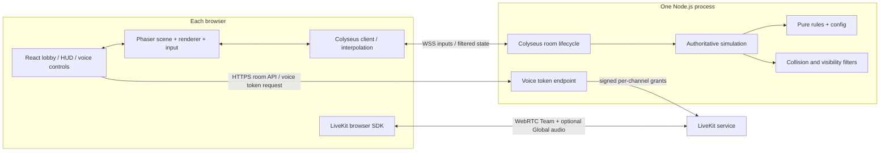

# OSMOSIS — Technical Architecture & Agent Guardrails

**Version:** 1.2 · **Status:** Binding implementation anchor · **Companion:** `PRD.md`

> The PRD owns player-facing behavior. This document owns modules, boundaries, protocols, trust, quality gates and implementation constraints. Agents must not silently swap stack, invent a database, introduce microservices or let client code resolve points/battles.

## 1. Locked technical decisions

| Concern | Decision |
|---|---|
| Client shell | React + TypeScript + Vite |
| Game rendering | Phaser 3 for 2D rendering; shared pure movement/collision rules for local prediction and server authority |
| Styling | Tailwind CSS for menus and HUD; DOM overlay above canvas |
| Multiplayer | Node.js + TypeScript + Colyseus room; WebSocket state/events |
| Source of truth | Colyseus server owns simulation, positions, collisions, LOS, score, clock, link state, pole ownership, elimination and results |
| Voice | LiveKit client SDK/WebRTC, private audio room per team plus one optional Global room per match round; channel tokens minted **server-side** |
| Persistence | None for v1; matches, parties and queues in memory; ephemeral signed reconnect tokens |
| Hosting | One Node.js game server + static web app; initial EC2 deployment uses Cloudflare Pages and a named Cloudflare Tunnel; optional separately hosted/self-hosted LiveKit |
| Matchmaking | Single-process in-memory party/queue coordinator; queue keys are team size and duration; no external broker or persistence |
| Workspace | pnpm monorepo with shared TypeScript domain/contracts |
| Browser playtests | Sibling `osmosis-stresstester` project; unit and room integration tests stay with the game source |
| Runtime stats | Dependency-free JSON endpoint using Node built-ins; bearer-token protected and disabled without `METRICS_TOKEN` |
| Target | Desktop web browsers; 4v4 or 5v5 rooms; 5–30 minute server-timed games |

**Version discipline:** pin working major/minor dependency versions at project initialization, commit lockfile, and document upgrades. Do not copy API examples from a different Colyseus major version without verifying documentation.

The game server imports its runtime APIs from `@colyseus/core` and pins the matching `@colyseus/ws-transport` peer directly. Keep matchmaking, room classes and WebSocket transport on one Colyseus runtime instance; the umbrella `colyseus` package resolved these through separate peer contexts in this workspace, causing every WebSocket seat reservation to appear expired.

## 2. Diagram



## 3. Repo boundaries

```text
osmosis/
  apps/
    web/
      src/
        pages/             # home, lobby, allocation, arena, results
        game/              # Phaser scenes, tilemaps, sprites, camera, fog
        ui/                # React HUD and menus
        net/               # typed Colyseus adapter, interpolation
        voice/             # LiveKit SDK wrapper, permissions, controls
    server/
      src/
        rooms/             # one ArenaRoom and its lifecycle/phases
        matchmaking/       # in-process parties, queues and match formation
        simulation/        # tick, movement, collision, battle, LOS
        systems/           # pickup, link, base, timer, reconnection
        security/          # input validation, privacy view, tokens
        http/              # health + voice-token endpoint
        observability/     # process and simulation runtime stats
  packages/
    shared/
      src/
        contracts/         # client commands / server events / types
        constants/         # rules, movement, arena dimensions, timings
        map/               # canonical collision and LOS geometry
  tests/
    integration/           # rooms, privacy, match orchestration
  docs/
    PRD.md
    ARCHITECTURE.md
```

Headful browser scenarios live in the sibling `osmosis-stresstester/` project. The current scenarios import the game source to stage deterministic fixtures, so they run the app source and browser in the same runner container. This project is deliberately separate from the game workspace and is not yet a load generator.

**Dependency rule:** `web` and `server` may import `shared`; `shared` imports neither. Phaser code never runs on the game server. Shared geometry is pure data and deterministic TypeScript math, not Phaser physics objects.

### Required separation of concerns

The current `ArenaRoom.ts` and `ArenaScene.ts` combine too many responsibilities. Refactor incrementally into the following boundaries within the existing applications; no new services or technologies are required.

| Boundary | Responsibility |
|---|---|
| Server room adapter | Colyseus connections, message routing, scheduling and sending results; delegates domain decisions |
| Server match model and orchestrator | Owns canonical match state and explicitly orders simulation systems; supplies immutable match settings, time and configuration |
| Server gameplay systems | Separate movement, contact/battle settlement, links, pickups, raids, poles/elimination and recovery; each changes only its documented state fields |
| Server lobby/session services | Allocation, readiness, phases, reconnect and role assignment |
| Server matchmaking coordinator | Owns ephemeral party/queue membership, matches compatible team-size/duration groups, and creates standard ArenaRooms; never owns gameplay state |
| Server snapshot projection | Recipient-specific visibility, score/status privacy and spectator views; gameplay systems never construct transport payloads |
| Shared pure rules | Movement/collision step, settlement, configuration and validated contracts; no browser, Phaser, Colyseus or network dependencies |
| Client network simulation | Input history, acknowledgments, prediction/reconciliation and remote snapshot buffers |
| Client scene composition | Creates and connects controllers/renderers, schedules updates and disposes resources |
| Client presentation modules | Map, characters, pickups, fog, links, camera, feedback and spectator controls; consume explicit view data |
| React HUD | Displays authorized snapshots and issues intents; never resolves gameplay outcomes |

Use explicit typed inputs/results and injected clocks where time matters. Avoid modules that merely call back into a giant room/scene or share unrestricted mutable state. Preserve behavior during extraction, then change rules in separate reviewable steps. Keep one authoritative state owner and a documented tick order. Add focused regression coverage for extracted behavior and room-level integration coverage for the complete sequence.

## 4. Authoritative simulation

- Fixed simulation step target **20 ticks/sec** (50ms); the client predicts local movement at 20Hz and interpolates remote avatars between snapshots.
- Clients send **intent** (`move` input direction, `interact`, `linkStart`, `linkStop`, `ping`), never coordinates as facts, scores or collision outcomes.
- Server computes speed-limited movement and canonical map collisions, then determines LOS, interactions and scoring.
- Client may predict **its own** movement and reconcile to server snapshots; remote players interpolate. No client-side optimistic score changes. Movement polish must preserve authoritative server movement and shared collision geometry.
- Process input sequence numbers/timestamps to reject stale or repeated commands; rate-limit inputs and HTTP endpoints.
- Validate immutable match settings at room creation: official `teamSize` is 4 or 5 and `matchDurationSeconds` is 300–1,800 in 60-second increments. Default to 5v5/900 seconds. Development-only 1v1 and 2v2 rooms remain gated by the existing test-room policy.
- Use server monotonic elapsed time for the configured match duration; expose remaining time to clients; server decides on the exact timeout. Rematches preserve the room's settings.
- The match is authoritative **even if a client opens devtools or tampers with Phaser**.

### State partitioning (critical)

**Do not broadcast complete raw game state to all clients.** Vanilla shared Colyseus schemas may expose every player's coordinates/points. Use per-client visibility (Colyseus State View if supported by pinned version, or carefully controlled client-specific snapshots), backed by server-side line-of-sight, to prevent hidden enemy leakage.

| Field | Authorized audience |
|---|---|
| Own points, status, position and movement-freeze timer | Self |
| Team roster and teammate positions/status | Same team |
| Teammate points | Same team (team strategy) |
| Enemy avatar position, name | Only while inside server-computed field-of-view and unoccluded |
| Enemy exact points and aggregate team score | Never in PLAYING snapshots; both team totals and every player's final balance are allowed in RESULTS payloads |
| Enemy temporary INACTIVE status/timer or movement-freeze timer | Never; keep the enemy avatar's ordinary spotted presentation |
| Permanent elimination | Eliminated player receives spectator state with zero points; a spotted opponent may see the permanent elimination, never its live numeric balance |
| Map obstacle geometry, visible pickups | Static public map; item visibility under local fog |
| Own aggregate team score | Same team only |
| Active Help ping requester ID and expiry | Requester's team only; render it at the authoritative position already present in the teammate snapshot |
| Team voice authorization | Member of matching team only |
| Global voice authorization | Connected member of the same match and round; Global audio is never routed through either private Team room |
| End-of-match score breakdown | All players receive both final team totals and every player's final balance, only after phase becomes RESULTS |

**Fog/security distinction:** A dark overlay alone is only visual; visibility **must also filter network data**. Team locations can appear on own minimap; enemy minimap is limited to currently spotted enemies (or omit enemy markers in v1).

**Score/status privacy:** Construct score and player-status fields per recipient on the server. Hiding a scoreboard value in React or masking an enemy sprite is insufficient if the value or `INACTIVE` state remains in the payload. Spectators inherit a living teammate's visibility scope; they do not receive a room-wide observer feed.

## 5. Match lifecycle / state machine

```text
CREATED -> LOBBY -> ALLOCATION -> COUNTDOWN -> PLAYING -> RESULTS -> LOBBY (rematch)
                              \-> LOBBY (cancellation)
```

Only server performs transitions. Lobby requires the configured room size/team; allocation must sum to 10,000/team, assign at least 500 to each player, and be locked; countdown requires all connected players ready; start initializes spawns, items, configured deadline and active status atomically. `RESULTS` is terminal for the round; rematch creates fresh round state without leaking prior scores and retains the room settings.

Player status is independent of match phase: `ACTIVE`, temporary `INACTIVE`, `ELIMINATED`, or `DISCONNECTED`. INACTIVE players may move but cannot collect pickups, link, raid or win an ordinary battle until their timer expires or they enter their own base. Contact between ACTIVE and INACTIVE opponents freezes only the ACTIVE player's movement for three server seconds; it changes neither player's status or score. The active freeze deadline is private to its player. Pole-holder contact takes precedence and permanently eliminates the touching opponent, clears their remaining points without transferring them, and emits a contact-scoped visual event. Battle settlement that reduces any player's individual balance to zero also permanently eliminates that player. `ELIMINATED` is permanent for the current round and retains its room membership with a zero balance; the client switches to spectator mode and remains in team voice. A spectator automatically follows a living teammate in deterministic roster order and receives only that teammate's filtered view. If every rostered player on a team is `ELIMINATED`, the other team wins immediately.

### Roles
- **Host:** can start/cancel countdown and rematch; not automatically a team captain.
- **Captain:** can submit/lock allocation for own team.
- **Player:** nickname, ready, move, battle, link, raid, voice, ping; an eliminated player may spectate but cannot submit gameplay actions.
- Role assignment and transfer are server-validated. Never trust a client-provided `isHost` or `isCaptain` flag.

## 6. Contracts (conceptual, version and validate actual payloads)

```ts
type ClientCommand =
  | { type: 'move'; seq: number; dx: -1 | 0 | 1; dy: -1 | 0 | 1 }
  | { type: 'interact'; targetId?: string }
  | { type: 'linkStart'; teammateId: string }
  | { type: 'linkStop' }
  | { type: 'ping' }
  | { type: 'ready'; ready: boolean }
  | { type: 'allocate'; pointsByPlayerId: Record<string, number> }
  | { type: 'lockAllocation' };

type MatchPhase = 'LOBBY' | 'ALLOCATION' | 'COUNTDOWN' | 'PLAYING' | 'RESULTS';
type PlayerStatus = 'ACTIVE' | 'INACTIVE' | 'ELIMINATED' | 'DISCONNECTED';

type MatchSettings = {
  teamSize: 1 | 2 | 4 | 5;      // 1 | 2 only for gated development test rooms
  matchDurationSeconds: number; // 300–1,800, divisible by 60
};
```

Use an explicit schema validator (Zod) at the network boundary. Send typed server events for `battleResolved`, `pointsChanged`, `itemCollected`, `raidStarted/Interrupted/Completed`, `playerInactive/Rearmed`, `playerEliminated`, `matchEnded`, and `error`. Battle feedback is sent only to the participants and contains their event-time positions/outcomes, not point balances. Pole-elimination feedback is sent only to the touching attacker and holder. Raid progress feedback is private to the raider. Never emit a points-change payload revealing opponent balance or temporary enemy inactivity. Event IDs are unique per round and clients deduplicate them.

### Client feedback rendering

- Keep feedback in the Phaser presentation layer. A typed, recipient-filtered game event confirms the outcome; the renderer may animate it but never changes score, status, movement or collision.
- Use Phaser 3.90 tweens and bounded particle bursts for tag impact/recoil, pole elimination, and raid start/completion/interruption. Keep effects short, clean them up, and render them below the fog layer so an event cannot reveal an unseen area.
- Use only a small set of local 2D VFX textures from Kenney Particle Pack (CC0); use simple Phaser shapes for broad area indicators so they remain legible without obscuring the playfield. Keep the license beside the assets and provenance in `assets/third-party/README.md`. Do not add an animation framework.
- Raid stage feedback goes only to its raider. Do not include point amounts in battle events or any hidden opponent data. The existing snapshot remains the source for authorized live score changes.

## 7. Gameplay systems and invariants

| System | Server invariant |
|---|---|
| Match settings | Validated once on room creation, immutable through play and rematch; included in lobby and gameplay/result snapshots |
| Team allocation | Exactly 10,000 per team for either team size; 100-point increments; each player starts at >=500; locked before start |
| Movement | Never crosses blocked tile or bounds; collision math deterministic. ACTIVE and INACTIVE may move unless the server freeze deadline is in the future |
| LOS | Occlusion computed from map wall segments; no unseen enemy position serialized |
| Battles | Ordinary contact between ACTIVE opponents resolves once. HQ location alone gives no immunity; a pole-holder contact is evaluated first |
| Score transfer | Winner gain equals loser debit, max 500; no negative scores; any participant whose balance becomes zero is eliminated in the same simulation step; simultaneous input ordering deterministic |
| Inactivity | Ordinary battle participants become INACTIVE for 15 server-measured seconds and retain movement; own base restores ACTIVE immediately, otherwise the timer does. They cannot collect pickups, link, raid or win a battle. Opponents never receive this temporary status or timer |
| Inactive contact | ACTIVE touching INACTIVE freezes only the ACTIVE player's movement for three server-measured seconds. No battle, point transfer or status change. The freeze is applied once per contact edge and never extends while the same contact persists. INACTIVE-INACTIVE contact has no effect |
| Elimination | Pole contact permanently marks the touching opponent ELIMINATED for the round, including an INACTIVE toucher; no timer/base/reconnect re-arm, no point transfer to the holder, and the eliminated player's balance is set to zero. Battle depletion to zero also eliminates. Pole resolution precedes battle and freeze rules. The room slot remains and the eliminated client becomes a filtered spectator |
| HQ pole | Replaces the earlier five-second combat boost. One active holder per team's pole. A teammate cannot enter an occupied pole zone; first eligible entrant owns it until leaving or becoming unavailable. Any non-eliminated enemy touching that holder, including an INACTIVE enemy, is immediately ELIMINATED; holder remains ACTIVE |
| HQ battles | If no pole-holder special case applies, contact inside a base resolves as an ordinary battle and transfers points under the normal rules |
| Links | Max two ACTIVE allies within range + LOS; terminate on distance, disconnect or inactivity |
| Pickups | Each pickup awarded once; award 200 to collector |
| Raids | 3s uninterrupted base interaction, 2,000 reward, 90s per-team raid cooldown; defenders interrupt |
| Finish | Exactly one server result; a fully ELIMINATED team loses immediately. Otherwise, at the configured deadline compare totals and draw on a tie |

**Collision resolution:** The shared pure movement step and AABB/circle geometry drive both server movement and local prediction. Phaser renders those positions; Phaser physics does not own gameplay collision. Resolve pole-holder contact before ordinary battle logic; do not treat the whole HQ zone as protection. Test boundaries and high-latency cases. Prefer collision shapes aligned with rendered container footprints.

**Combat trigger:** Resolve pole-holder contact first. Otherwise, ACTIVE-ACTIVE contact starts a battle on the first contact edge, not every frame while two sprites overlap. ACTIVE-INACTIVE contact freezes the ACTIVE player without scoring; INACTIVE-INACTIVE contact is ignored. A short contact lock prevents repeated freezes until the players separate.

**Movement quality follow-up:** The current 20Hz authoritative simulation and snapshots remain the baseline until measured. Capture input sequence, server tick/snapshot timing, displayed position, authoritative position, and correction size under local and tunneled connections before tuning. Prefer timestamped remote snapshot interpolation and bounded local reconciliation; keep server movement and canonical collision geometry authoritative. Do not raise simulation frequency solely to mask visual jitter.

**Movement implementation plan:** Share deterministic movement/collision stepping between server simulation and local prediction. Record numbered input steps with explicit simulation timing; the server acknowledges inputs actually simulated, not merely received. The client restores the acknowledged authoritative state, discards acknowledged history and replays pending input steps. Bound input history and validate timing so replay cannot grant extra movement. Correct simulation state immediately while smoothing a separate render offset for small errors; reserve hard resets for discontinuities or unrecoverable errors. Interpolate remote players through a timestamped snapshot buffer and clear stale history on visibility loss, reconnect or respawn. Never replay pickup rewards or battle outcomes as part of movement prediction.

The previous 96-unit hard-correction threshold was too large relative to the 38-unit pickup radius. Reconciliation now smooths render-only corrections up to 40 units and snaps larger errors. A movement trace can correlate apparent misses or jumps with acknowledged input and authoritative distance; the trace does not prove a runtime symptom until captured. Reference approaches: [prediction and reconciliation](https://www.gabrielgambetta.com/client-side-prediction-server-reconciliation.html), [remote interpolation](https://gabrielgambetta.com/entity-interpolation.html), and [Colyseus prediction](https://docs.colyseus.io/netcode/client-prediction).

## 8. Voice architecture

- Client joins its private Team LiveKit room after explicit opt-in; Blue and Red use separate rooms named `room-code:round-id:team-id`.
- One additional match-wide room, `room-code:round-id:GLOBAL`, carries only audio intentionally sent to Global. Global receive is independently opt-in and does not require leaving Team voice.
- Client requests a server token for a channel using its signed player credential. The server derives team membership, round and room name from authoritative room state. A requested `TEAM` token permits only the player's assigned Team room; a `GLOBAL` token permits only that match's Global room. Never trust a client-supplied team, room name or round.
- Use separate LiveKit client sessions for Team and Global so subscriptions can be controlled independently. Global opt-out unsubscribes Global audio tracks while preserving Team audio. Global sessions connect only when the player listens or selects Global transmission.
- The outgoing microphone target is exactly one channel at a time. Switching target mutes the old channel before the new one can publish; selecting a target never unmutes automatically. One local DEAFEN control silences incoming audio from both sessions; Global mute affects Global reception only.
- Voice disconnect or denial must not block game join. Game reconnect, rematch, explicit voice leave and unmount clean up both LiveKit sessions; opted-in sessions may rejoin muted after game reconnect/rematch.
- Never ship LiveKit API secret to browser; do not record voice; issue short-lived, channel-scoped tokens only for connected room members.
- Use `V` as a microphone toggle for the selected transmit target with displayed state matching LiveKit's actual microphone state; begin muted and handle no-audio-device and browser autoplay policies gracefully.

## 9. Room identity, reconnection and failures

- Assign stable `playerId` independent from Colyseus transport `sessionId`.
- Use the Colyseus-issued unpredictable reconnection token, stored by room code in browser `localStorage` (never in the URL). Persistent storage is required because the supported recovery case includes closing and reopening the browser; `sessionStorage` may disappear with the tab. Migrate any legacy session token once. Never use a nickname alone for authentication. Clear the token on an explicit leave or when the matchmaker rejects it.
- Reserve a disconnected player slot for **120 seconds**, measured by the server. On disconnect, mark the player non-interactable and freeze movement; preserve team points and the prior gameplay status. Reconnect with the token restores the same player and voice authorization. If the player was already ELIMINATED, reconnect restores spectator mode and never reactivates them.
- After the grace period, retain the frozen player record and points until match end so team totals remain deterministic; no new participant fills a slot mid-match. In the lobby, remove the expired player and invalidate readiness. A failed token reconnect must not silently fall back to a new seat; show an explanation and let the user explicitly join again if the room permits it.
- An intentional Leave Room action clears the saved token. While connected, it leaves without a reconnection reservation; during a match the disconnected record and points remain until results, while a lobby slot is freed immediately. If the client is already offline, it cannot signal that intent to the server, so its reserved seat expires within the 120-second grace period.
- Transfer host or captain role using the deterministic eligible-player rule when a player disconnects or explicitly leaves. A connected eliminated host remains host while spectating; a returning player does not automatically reclaim reassigned privileges.
- Network errors show reconnect UI; simulation continues on server. Empty room disposal is delayed through reconnect window.
- Show a compact in-match game-server connection indicator using the Colyseus room's built-in `ping()` round trip every three seconds. Label RTT up to 100 ms GOOD, 101–200 ms FAIR, and over 200 ms WEAK; show CHECKING before the first response, NO SIGNAL when a response takes over five seconds, and RECONNECTING/OFFLINE from transport state. This is client-side feedback only: it does not affect the authoritative simulation and does not measure LiveKit voice quality.

## 10. Security and privacy constraints

1. Server validates team membership, proximity, LOS, cooldowns, coordinates, room phase, role and resource balances.
2. Never trust client scores, collision claims, timers, item IDs or claimed opponent IDs without server checks.
3. No private enemy data in snapshots, event logs returned to clients, minimap caches or React state.
4. Reconnect/session tokens and voice credentials are signed, scoped, short-lived; use HTTPS/WSS in deployment.
5. Rate-limit creates, joins, movement and token issuance; sanitize nicknames; cap request lengths.
6. Team and Global voice are opt-in with clear channel-specific mute and full deafen controls; no voice recording and no unnecessary personal data collection.
7. Quick Play stays disabled in production by default. Before enabling public access, operators must decide how structured abuse reports in server logs will be reviewed. Private invite rooms remain available independently.

The 1v1 and 2v2 room modes are temporary test-only options. The client exposes them in development builds; the server rejects them when `NODE_ENV=production` unless `ENABLE_TEST_ROOM_MODES=true` is explicitly set for a controlled test deployment.

## 11. Deployment and observability

```text
Player browser --HTTPS--> Cloudflare Pages (static web build)
Player browser --HTTPS/WSS--> Cloudflare edge --> named Tunnel
                                      --> cloudflared on EC2
                                      --> one Node.js/Colyseus process:2567
Player browser --WebRTC/WSS--> LiveKit service (ICE/TURN as required)
Game server --signed, scoped voice token--> browser
```

- Single Node instance is **intentional** for v1; room state, party membership and matchmaking queues remain in one process. A restart ends matches and clears queues. Horizontal scaling requires a separate architecture decision for shared room/queue coordination.
- The production Compose definition is `deploy/compose.production.yaml`. It runs the Node server and a pinned `cloudflared` connector on a private Docker bridge; it publishes no application ports on the EC2 host. Configure the named tunnel's public hostname `game.<domain>` to forward to `http://game-server:2567`. Host the static web build separately, with `VITE_GAME_SERVER_URL=https://game.<domain>` baked in and `CLIENT_ORIGINS` set to the exact web origin. The named tunnel is only the public network path; it does not make the in-memory game server highly available or preserve rooms through restarts.
- EC2 accepts SSH only from the administrator's IP. Player HTTP and WebSocket traffic reaches the app through the tunnel's outbound connector; browser voice signaling/media connects directly to LiveKit. Do not route WebRTC media through the game server or Cloudflare Tunnel.
- `.github/workflows/deploy-ec2.yml` runs typecheck, tests and builds on pull requests and server/shared/production-infrastructure pushes to `main`; only successful `main` pushes deploy. Frontend-only changes publish through Pages without restarting the game server. The deploy job uses GitHub OIDC to assume a narrowly scoped AWS role and sends the update over Systems Manager Run Command, so GitHub runner IPs do not need SSH access and long-lived AWS keys are not stored in GitHub. See `docs/DEPLOYMENT.md` for IAM setup.
- The in-memory matchmaking coordinator groups parties without splitting them and forms two exact teams at the configured team size. Queue keys include team size and one of the documented Quick Play duration presets. Disconnected queue members pause eligibility during the 120-second reconnect grace; after the grace expires the affected queue ticket is removed. Handoff reserves all seats in one ordinary ArenaRoom, keeps the queue connection until the client joins and stores its Arena reconnect token, and expires an incomplete lobby handoff after 120 seconds. Allocation, readiness and gameplay remain ArenaRoom's responsibility. Abuse reports are validated and rate-limited by ArenaRoom and emitted as structured JSON to server stdout; no persistence or moderation service is introduced. Do not add a database, Redis, broker or matchmaking service for this single-instance launch.
- Environment keys: client game URL, server CORS origin, LiveKit URL, LiveKit API key/secret, token signer secret, and `ENABLE_QUICK_PLAY`; env example is committed, real secrets are not. Quick Play is enabled automatically outside production and remains disabled in production unless explicitly set to `true`.
- Log room creation, join/leave/reconnect, phase transitions, battle/raid aggregate counts and exceptions; do not log audio, raw voice tokens or sensitive credentials.
- The private `/internal/metrics` endpoint reports room and connected-player counts, process CPU/memory, event-loop delay, and rolling simulation tick duration/interval percentiles. It uses Node built-ins, returns JSON, and is disabled unless `METRICS_TOKEN` is set. Extend this as server instrumentation for patch latency, disconnects, rejected commands, and voice join failures is added.
- Add `/health`; use graceful shutdown, clearly warn that an in-memory server restart ends ongoing matches.

## 12. Testing strategy and definition of done

**Unit (pure rules):** allocation totals, tie handling, capped transfers, linked settlement (including one player at zero), pole-holder elimination precedence, exclusive pole ownership, permanent elimination, 15-second inactivity and re-arm, raid interruption, cooldowns, deterministic ordering, timer boundaries, occlusion segment tests.

**Integration (server):** two Colyseus clients in a room; complete 4v4 and 5v5 allocation/start with >=500 per player; validate duration boundaries and reject forged score; walls stop movement; hidden enemy omitted from client snapshot; enemy inactivity and opposing score fields absent from every PLAYING payload; RESULTS includes both team totals, every player balance and match settings; zero-balance and pole eliminations clear points and preserve spectator behavior; only event participants receive tag feedback; Team/Global token scopes and private Team-room isolation; rematch preserves settings and resets round state; two-room isolation. M7 adds party integrity, queue matching/cancellation and abuse/rate-limit coverage.

**E2E (browser):** create room -> join -> choose teams -> allocate -> start -> walk/tag/collect/raid -> pole elimination -> spectate -> results; verify HQ fights without a pole holder; verify score/status privacy; mic denial fallback; browser refresh and rejoin. Use deterministic debug/accelerated clock only in test mode, not production gameplay.

**Performance baseline:** use the sibling `osmosis-stresstester` to fill standard rooms with ten Colyseus clients each, complete the lobby, and send valid movement inputs at 20Hz while sampling the private server metrics endpoint. This measures authoritative server and room traffic; browser rendering remains a separate headful check. Measure before optimizing.

**Completion requirement for every milestone:** working feature, corresponding tests, no server-leaked hidden state, and one short note in `docs/DECISIONS.md` for any deviation.

## 13. Agent guardrails / no-go rules

- **Do not** replace Phaser with canvas primitives, Pixi, Three.js, Unity or a homegrown engine unless explicitly approved.
- **Do not** move authoritative scoring/collision/visibility into React/Phaser.
- **Do not** broadcast all players and merely hide enemies with CSS/fog.
- **Do not** send opposing numeric scores or temporary inactivity status and rely on the client to hide them.
- **Do not** add PostgreSQL, Redis, Kafka, microservices or accounts for the v1 vertical slice. Matchmaking is an in-process module under the intentional single-node deployment.
- **Do not** implement voice over the Colyseus gameplay WebSocket; use WebRTC/LiveKit.
- **Do not** let visual prototype's client-only logic become production source of truth.
- **Do not** silently alter the PRD's base/transfer/link rules when implementation is awkward; write a decision and tests first.
- **Do** maintain one canonical rules configuration, one canonical map/collision representation, explicit client/server contracts, and minimal dependencies.
- **Do** build in PRD milestone order, test at each gate and keep app launchable.

## 14. Reference docs
- Phaser Arcade Physics: https://docs.phaser.io/phaser/concepts/physics/arcade
- Colyseus rooms: https://docs.colyseus.io/room
- Colyseus state and State View: https://docs.colyseus.io/state
- LiveKit React docs: https://docs.livekit.io/transport/sdk-platforms/react/

**Implementation instruction to coding agent:** First read both docs. Produce a brief implementation plan mapped to M0–M6 and identify any contradictions. Begin with M0 and M1. Don't scaffold unrelated systems or attempt full gameplay before camera, collision and LOS prototype feel correct.
